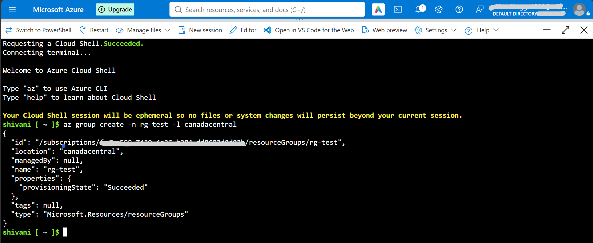

Module 1: Compute
## Goal
Create, connect to, and troubleshoot Linux and Windows virtual machines in Azure using the portal and Azure CLI (Bash), including disks and snapshots.
## What I built
- Ubuntu VM via the portal (SSH key, auto-shutdown)
- Ubuntu VM via Azure CLI with nginx and an open port 80
- A Windows Server VM reached over RDP
- A data disk (attached, formatted, mounted) and an OS disk snapshot
- VM lifecycle operations: stop, deallocate, start, resize, run-command
## Steps
### Portal VM

### CLI VM
Script: [create-linux-vm.sh](scripts/create-linux-vm.sh)

### Windows VM

### Disks and snapshot

## Troubleshooting log
| # | What I did | Symptom | Cause | How I found it | Fix |
|---|---|---|---|---|---|
| 1 | Removed the SSH NSG rule | [real error] | Port 22 blocked by NSG | rule list, /dev/tcp port test | `az vm open-port --port 22` |
| 2 | SSH as wrong user | [real error] | Wrong username or key | Compared user and key | Used `azureuser`, or reset key with `az vm user update` |
| 3 | Key permissions 644 | [real error] | Private key readable by others | Read the warning | `chmod 400` |
| 4 | Deallocated the VM | [real error] | VM was not running | `az vm list -d` showed deallocated | `az vm start` |
| 5 | Rebooted VM | [real output] | Mount not in /etc/fstab | `df -h`, `lsblk` | Added a UUID entry to fstab |
| 6 | Filled the data disk | [real error] | Disk 100% full | `df -h`, `du -sh` | Deleted the file or grew the disk |
| 7 | Used an invalid size | [real error] | Size does not exist or is unavailable | `az vm list-skus` | Chose a valid size |
Screenshots:        
## What I learned
- Stopped vs deallocated: only deallocated stops compute billing.
- A timeout usually means the network blocks traffic. A refusal or permission error means the machine answered.
- Disks and snapshots still cost money when the VM is off.
- Mounts need an fstab entry to survive a reboot.
## Cleanup
Deleted `rg-m1-compute`. Cost after cleanup: [number or screenshot].

